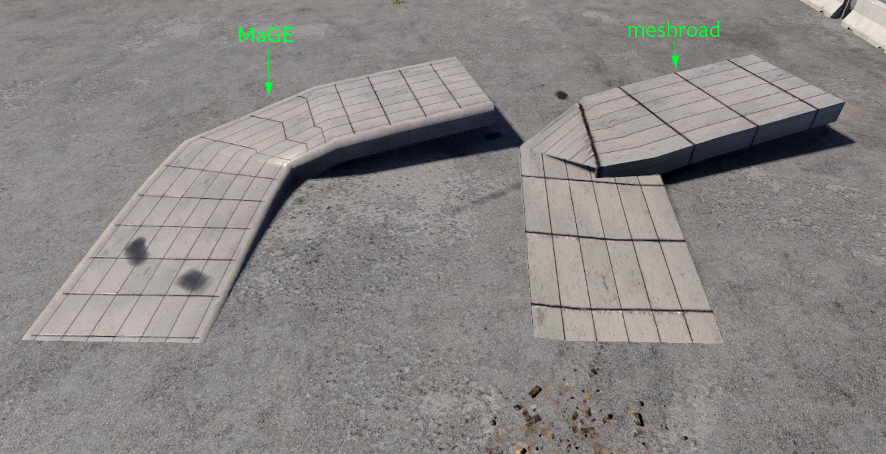
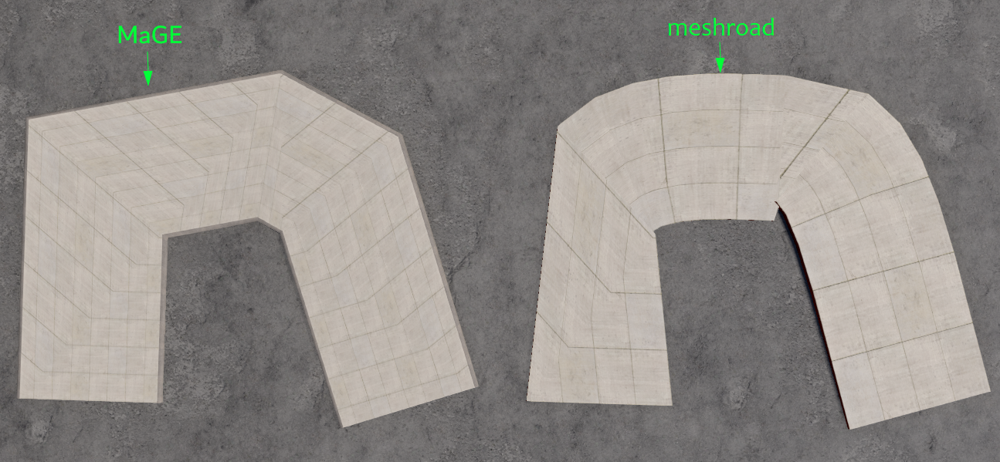
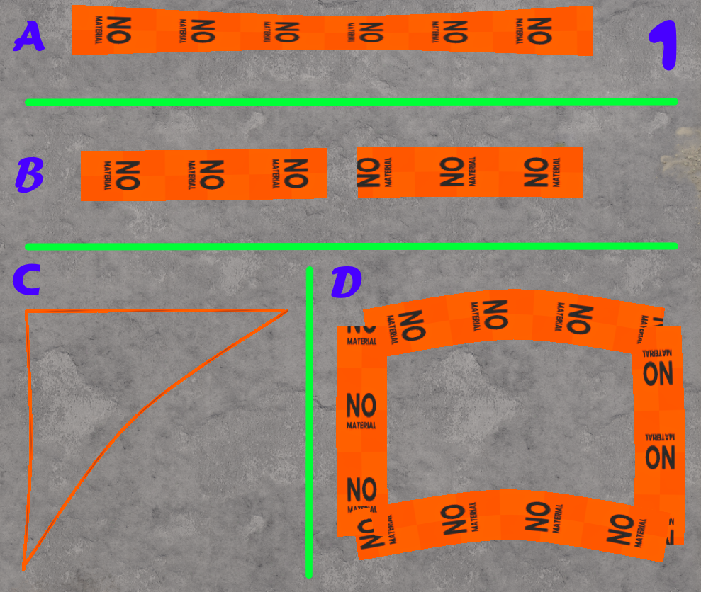
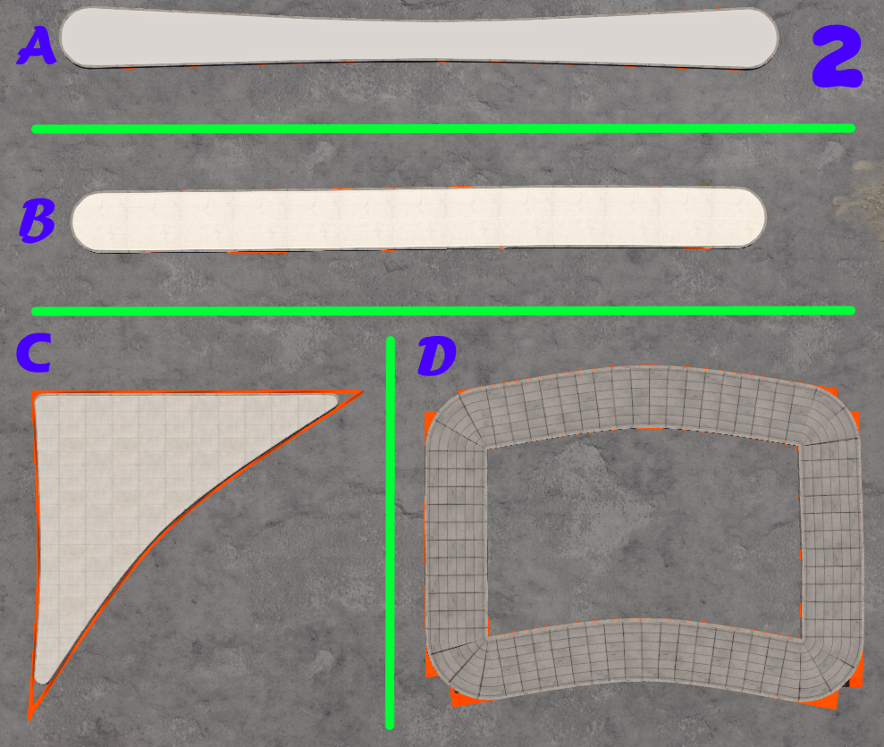
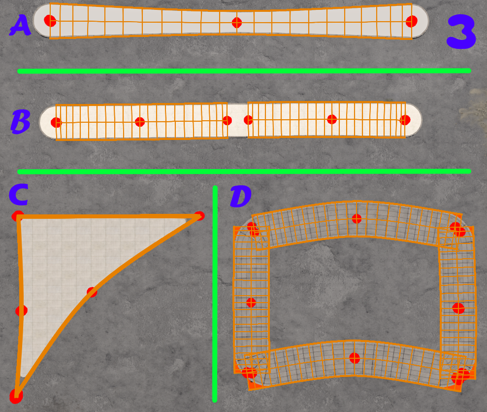
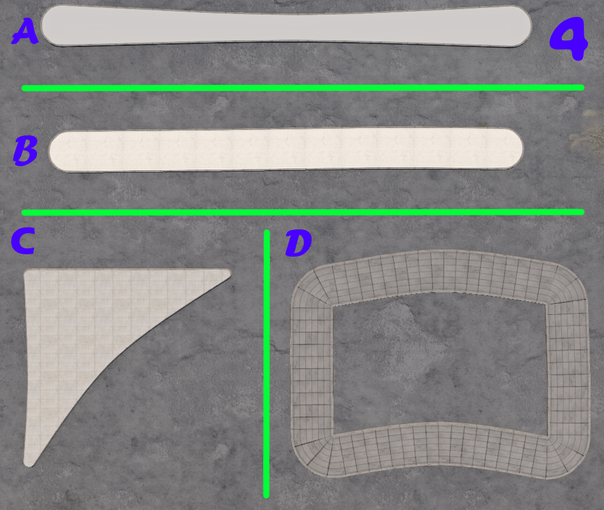

<p align="center">
  <picture>
    <source media="(prefers-color-scheme: dark)" srcset="images/logo_White.png">
    
  </picture>
</p>

<h1 align="center">MaGE - Map Geometry Engine</h1>

<p align="center">
  A BeamNG World Editor tool that turns MeshRoads and DecalRoads into sidewalks, walls, bridges and buildings, and saves them in the map as permanent objects with collision.
</p>

<p align="center">
  Everything is built inside the game, no Blender and no Python.
</p>

---

## What you can build

| | |
|---|---|
| **Sidewalks and traffic islands** | Curbs, walkways and islands from DecalRoads, including joins at junctions |
| **Walls and bridges** | From MeshRoads: textured walls, top surface, bridge railings, battlements and gates |
| **Buildings [BETA]** | A building in one click, floors that snap onto each other, the game's windows and doors |
| **Import** | Save Road Architect roads and Building Architect buildings as permanent objects |

**The same MeshRoad, two results.** On the right, the MeshRoad itself; on the left, what MaGE built from it:





---

## Installation

**1.** Copy `MaGE_1.0.0.zip` as-is, without extracting it, into:

```
%LOCALAPPDATA%\BeamNG\BeamNG.drive\current\mods\
```

**2.** In the World Editor (F11): **Window → MaGE → Map Geometry Engine**.

*Tested on BeamNG.drive 0.39.*

---

## Usage

**1.** First time on a map: **settings** tab → **create config**.

**2.** Select MeshRoads or DecalRoads in the SceneTree and click **apply the warning material**. MaGE only works on marked roads, so existing roads on the map are not touched.

**3.** Pick a style in the **sidewalks** or **MeshRoads** tab.

**4.** **render selection** shows a preview. **update objects** saves to the map.

> The preview is not saved with the map. Only **update objects** writes files.

---

## What to draw

| You draw | You get |
|---|---|
| DecalRoad | A sidewalk at the width of each node. Ends up to 2.5 m apart join by themselves |
| DecalRoads under 0.5 m wide in a closed loop | A filled traffic island with a curb |
| MeshRoad | A wall, a bridge or a building floor |

> For a sidewalk to follow the ground, untick **overObjects** on the DecalRoad.



**A:** one DecalRoad whose width changes between nodes. **B:** two DecalRoads close together with a gap between them. **C:** thin DecalRoads in a closed loop. **D:** four wide DecalRoads forming a rectangle.



**A** got exact width and rounded ends. **B** joined into one strip. **C** became a filled island. **D** got four connected corners without drawing a single turn.

> **C vs D:** the exact same shape. Thin DecalRoads give an island, wide DecalRoads give a sidewalk around a gap.

---

## Hide, don't delete

The roads you drew are the source. If you delete them, the next update deletes what was built from them too. **Only hide them.**

The three icons in the second toolbar row select, hide and show all marked roads in one click.





> Don't edit or move the `mage_*` objects. They are rewritten on every update.

---

## What is saved in the map

| File | |
|---|---|
| `mage_styles.json` | The map's styles (in the map folder) |
| `art/shapes/mage/mage_*.dae` | The built objects, one file per area |
| `art/shapes/mage/*.materials.json` | The materials the mod uses |

---

## Languages

The tool is translated into 14 languages and follows the game's language.

> **The translations are machine-translated and haven't been checked by native speakers.** If you find a wrong string in your language, open an Issue. Even a one-string fix is welcome.

---

## Credits

The geometry was originally written in Python by **rtacyyv**.

**AI use:** translating the geometry algorithms from Python to Lua was done with AI.

---

## License

[AGPL-3.0](https://www.gnu.org/licenses/agpl-3.0.html)
