<p align="center">
  <picture>
    <source media="(prefers-color-scheme: dark)" srcset="images/logo_White.png">
    
  </picture>
</p>

<h1 align="center">MaGE - Map Geometry Engine</h1>

<p align="center">
  A BeamNG World Editor tool that turns MeshRoads and DecalRoads into sidewalks, traffic islands, walls, bridges and buildings, and saves them in the map as permanent objects with collision.
</p>

<p align="center">
  Everything is built inside the game, no Blender and no Python.
</p>

<p align="center">
  <a href="https://www.youtube.com/watch?v=mDCQ67WTRtw">
    
  </a>
  <br>
  <em>Click the image to watch the teaser.</em>
</p>

---

## What you can build

| What | How |
|---|---|
| **Sidewalks and traffic islands** | Curbs, walkways and islands from DecalRoads, including joins at junctions |
| **Walls and bridges** | From MeshRoads: textured walls, top surface, bridge walls, battlements, gates and openings |
| **Buildings [BETA]** | A building in one click, one MeshRoad per floor, the game's windows and doors and 22 kinds of models and trims |
| **Whole streets** | Saved buildings placed along roads, from one road up to every road on the map |
| **Export and import** | A building as a skeleton to reuse, or as a baked DAE that works on any map without MaGE |
| **Saving the game's tools** | Road Architect roads and Building Architect buildings as permanent objects |

**The same MeshRoad, two results.** On the right, the MeshRoad itself; on the left, what MaGE built from it:


---

## Installation

**1.** Copy `MaGE_1.0.2.zip` as-is, without extracting it, into:

```
%LOCALAPPDATA%\BeamNG\BeamNG.drive\current\mods\
```

**2.** In the World Editor (F11): **Window → MaGE → Map Geometry Engine**.

*Tested on BeamNG.drive 0.40. What was built with earlier versions keeps working.*

---

## How it works

**1.** First time on a map: **create config** (in the toolbar or the **settings** tab). This creates `mage_styles.json` in the map folder with a starter set of materials.

**2.** Select MeshRoads or DecalRoads in the SceneTree and click **apply the warning material**. MaGE only works on marked roads, so existing roads on the map are not touched.

**3.** Pick a style in the matching tab. Every choice is saved as a tag (a dynamic field) on the road itself.

**4.** **render selection** shows a preview. **update objects** writes the files and places the objects in the map.

> The preview is not saved with the map. Only **update objects** writes files.

### Hide, don't delete

The roads you drew are the source. If you delete them, the next update deletes what was built from them too. **Only hide them.** Building floors are hidden by themselves after building.

> Don't edit or move the `mage_*` objects. They are rewritten on every update.

---

## Toolbar

| Button | What it does |
|---|---|
| **apply the warning material** | Marks the selected roads as a MaGE source |
| **render selection** / **clear preview** | Preview of the selected roads / clears it |
| **auto refresh** | Renders the preview again on every change to a road or a setting |
| **update objects** | Writes only the areas that changed and places them in the map |
| **rebuild all objects** | Rewrites everything MaGE built on the map |
| **reload config** | Loads `mage_styles.json` again after a manual edit |
| **expand all** / **collapse all** | Opens or closes all the groups in the tab |
| Select / hide / show | The three icons in the second row select, hide and show all marked roads in one click |

---

## sidewalks tab - sidewalks and islands

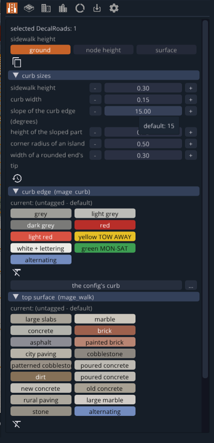

| Control | What it does |
|---|---|
| **sidewalk height** | `ground` - follows the terrain. `node height` - at the height of the nodes. `surface` - on the first surface under the nodes (like the DecalRoad's overObjects) |
| **curb sizes** | Sidewalk height, curb width, slope and height of the sloped part, corner radius of an island, width of a rounded end. Hovering a value shows its default, the clock icon puts the defaults back |
| **curb edge** | The curb texture, including parking-rule colors and `alternating` |
| **top surface** | The walkway texture |
| **curb profile** | `sidewalk` or `traffic island` |
| Copy | Copies all the settings from one road to another |
| Crossed-out X | Removes the tag and goes back to the config's default |

<br clear="right">

| You draw | You get |
|---|---|
| DecalRoad | A sidewalk at the width of each node. Ends up to 2.5 m apart join by themselves |
| DecalRoads under 0.5 m wide in a closed loop | A filled traffic island with a curb |


**A:** one DecalRoad whose width changes between nodes. **B:** two DecalRoads close together with a gap between them. **C:** thin DecalRoads in a closed loop. **D:** four wide DecalRoads forming a rectangle.


**A** got exact width and rounded ends. **B** joined into one strip. **C** became a filled island. **D** got four connected corners without drawing a single turn.

> **C vs D:** the exact same shape. Thin DecalRoads give an island, wide DecalRoads give a sidewalk around a gap.

---

## MeshRoads tab - walls, bridges and battlements

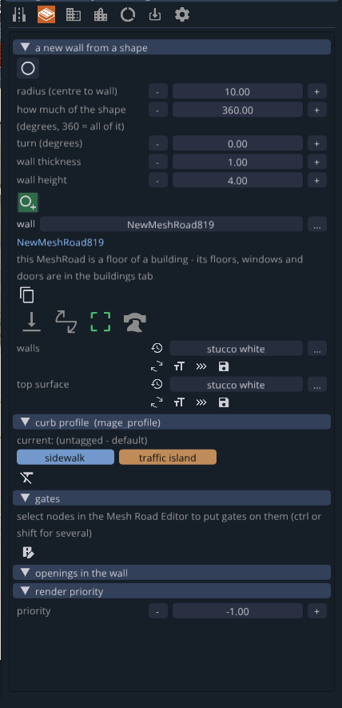

| Control | What it does |
|---|---|
| **a new wall from a shape** | A circle or arc wall: radius, how much of the circle, turn, thickness and height. The green circle with + creates it under the camera |
| **wall** | The selected MeshRoad. If it is a building floor, its settings are in the **buildings** tab |
| The four toggles | `bottom faces`, `banking from nodes`, `end curbs` (closes the ends), `battlements` |
| **walls** / **top surface** | The texture of the walls and of the top surface |
| **gates** | Select nodes in the Mesh Road Editor (ctrl or shift for several) and put gates on them |
| **openings in the wall** | Openings and niches in the wall |
| **render priority** | Which one is built on top when two MeshRoads overlap |

<br clear="right">

MeshRoads with the same tags whose ends touch are built as one continuous wall. A wall with a different texture, or a T junction, stays separate.

---

## Textures

Every texture field opens a picker with these groups: `my configurations`, `Building Architect textures`, `solid textures from the map`, `solid vanilla textures` (textures of the game's other maps), `all the map's textures`, `all vanilla textures`. Hovering a texture shows it on the building before you pick it, Esc puts it back.

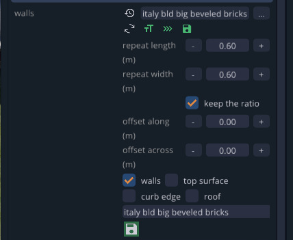

| Icon | What it does |
|---|---|
| Clock | Default |
| Turning arrows | Turns the texture by 90° |
| **Tt** | Repeat size (length and width in meters, can keep the ratio) |
| **»»»** | Offset along and across |
| Save | Saves it as a configuration in `my configurations`, for all maps, with a choice of which surfaces it fits |

A texture from another map is copied as a material into the current map.

---

## buildings tab - buildings [BETA]

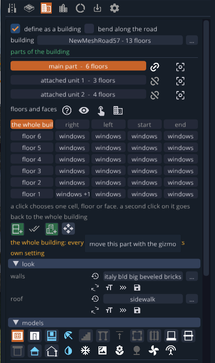

| Control | What it does |
|---|---|
| **define as a building** | Turns the selected MeshRoad into a building floor |
| **bend along the road** | Bends the building along the nearest road (up to 40 m) and keeps its distance from it. Turning it off makes it straight again |
| **building** | The current building and its number of floors |
| **parts of the building** | The main part and attached units. Chain - a linked part gets model and texture changes from the other parts. Frame - looks at the part |
| **floors and faces** | A table: a row for each floor, a column for each face (`right`, `left`, `start`, `end`). A click chooses a cell, a floor or a face, a second click goes back to the whole building |
| ? | How to tell the faces apart: the No Texture writing on the MeshRoad, clockwise |
| Eye | Four states: skeleton / building / both / none |
| Hand | Choose in the world: a click on a wall, a floor's top or a balcony marks it in the table. A window or a door is chosen on its own, to move, remove or change it. shift or ctrl adds |
| Under the table | Add a floor, multiple choice, add an attached unit, move the part with the gizmo |
| **push the wall** | Moves a wall with an arrow, in steps or freely, the whole wall or only from this floor up |
| **look** | The texture of the walls and the roof |
| **models** | 22 kinds of models and trims (in the table below) |

<br clear="right">

Every value applies to what is chosen in the table. What is set for a cell, a floor or a face wins over the setting of the whole building. Every action is one undo step (Ctrl+Z / Ctrl+Y).

### Models and trims

| Model | What it does |
|---|---|
| **windows** | The game's windows: model, depth in the wall, gap, height, alignment. No window, only an opening, or an opening with the chosen window <details><summary>Screenshot</summary>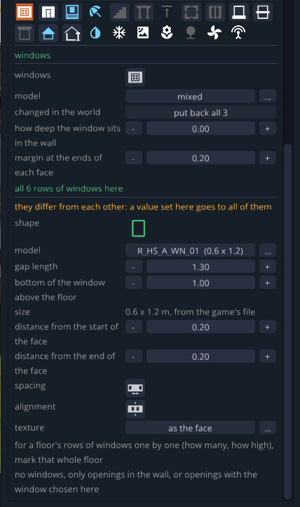</details> |
| **doors** | Doors one by one on a face: model, height, position. Only the opening or with the door, including an arched opening <details><summary>Screenshot</summary>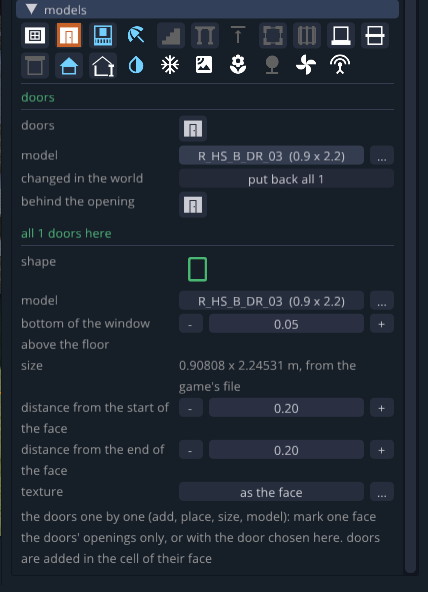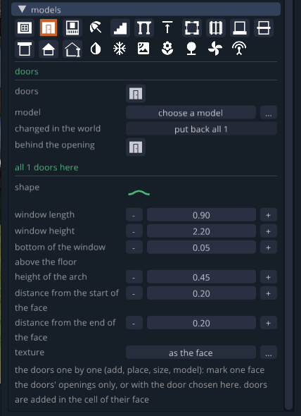</details> |
| **balconies** | Under every n-th window, from the second floor up: height, depth, width <details><summary>Screenshot</summary>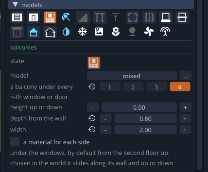</details> |
| **awnings** | Over the windows <details><summary>Screenshot</summary>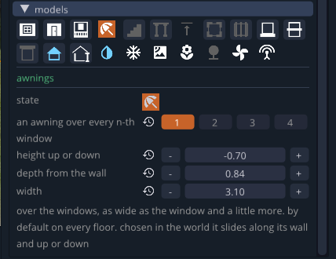</details> |
| **stairs** | In front of the doors, going down from their bottom <details><summary>Screenshot</summary>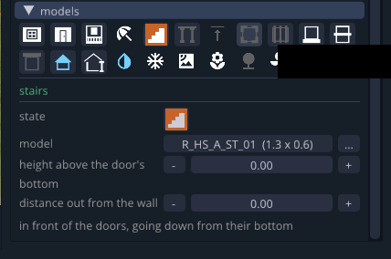</details> |
| **pillars** | Under a floor that sticks out over the floor below <details><summary>Screenshot</summary>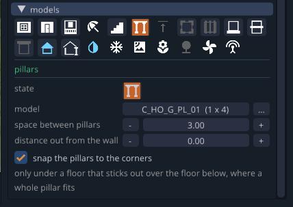</details> |
| **corbels** | Under a floor that sticks out <details><summary>Screenshot</summary>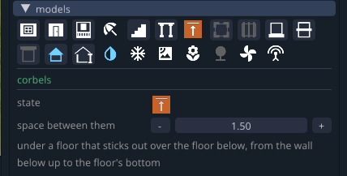</details> |
| **corners** | A trim on the corners of the floor, as high as the floor <details><summary>Screenshot</summary>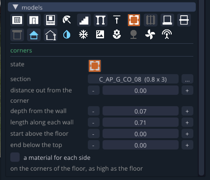</details> |
| **wall pilasters** | Flat columns at the ends of each face, and between windows if you want <details><summary>Screenshot</summary>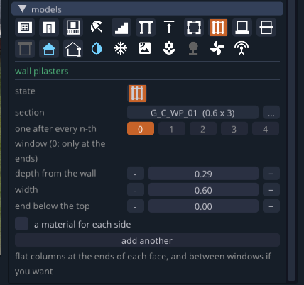</details> |
| **plinth** | A trim along the bottom, on the ground floor <details><summary>Screenshot</summary>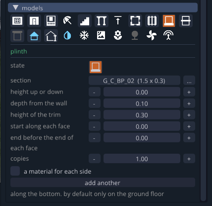</details> |
| **string course** | A trim where one floor meets the next <details><summary>Screenshot</summary>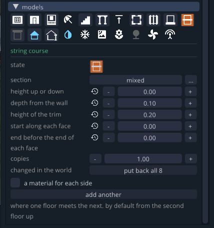</details> |
| **roof border** | A trim along the top, on the top floor <details><summary>Screenshot</summary>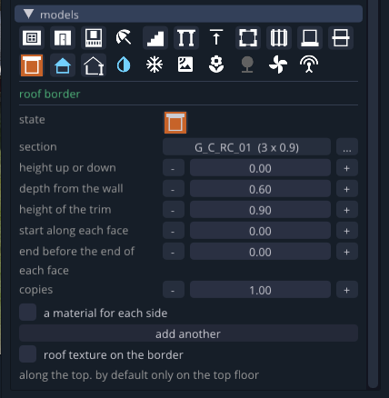</details> |
| **roof** | A pitched roof: shape, pitch, overhangs, thickness, ridge position, ridge cap, on the whole floor or on part of it <details><summary>Screenshot</summary>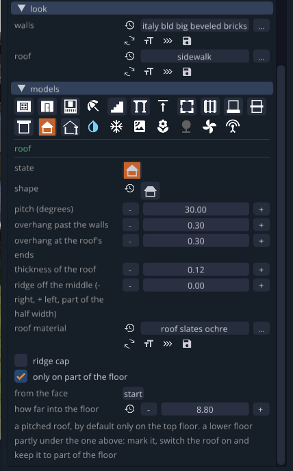</details> |
| **gutters** | Along the eaves of a pitched roof <details><summary>Screenshot</summary>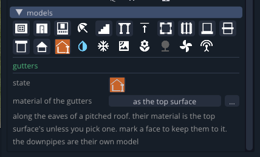</details> |
| **downpipes** | From the ground up to the roof, near the corners <details><summary>Screenshot</summary>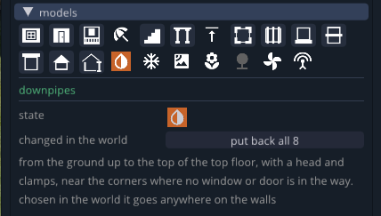</details> |
| **air conditioners** | Beside the windows <details><summary>Screenshot</summary>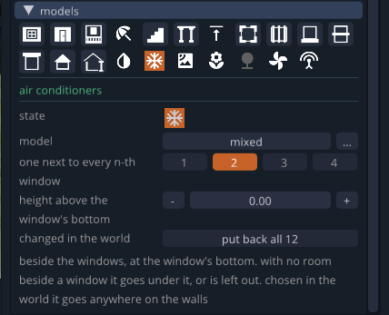</details> |
| **satellite dishes** | High on the wall <details><summary>Screenshot</summary>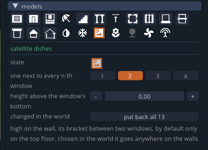</details> |
| **flower boxes** | Under the windows, not where there are balconies <details><summary>Screenshot</summary>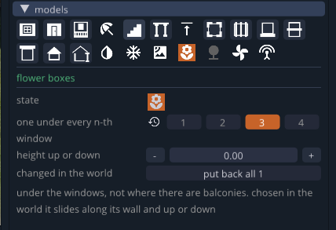</details> |
| **plant pots** | Along the edge of a flat roof <details><summary>Screenshot</summary>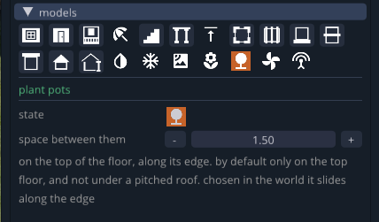</details> |
| **air conditioners on the roof** | On a flat roof <details><summary>Screenshot</summary>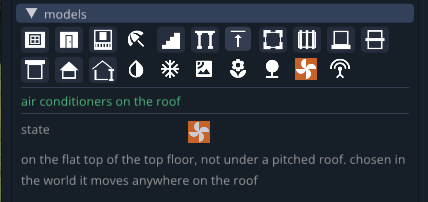</details> |
| **satellite dishes on the roof** | On a flat roof <details><summary>Screenshot</summary>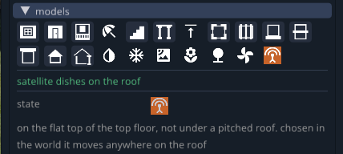</details> |

Every trim has: a section from the game, height, depth, start and end along the face, copies, `add another` for one more layer and `a material for each side`. A model moved in the world stays where it is, and **put back all** puts them all back.

---

## place buildings tab - placing buildings

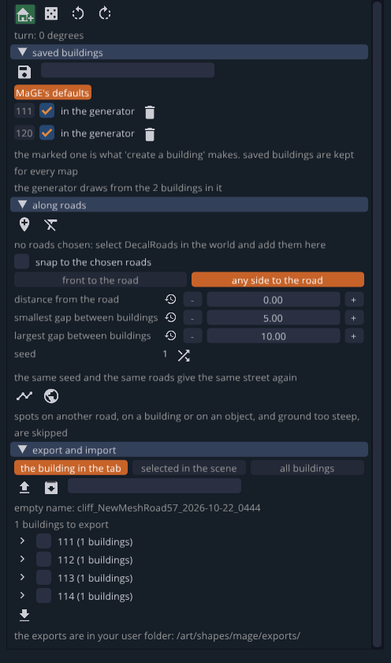

| Control | What it does |
|---|---|
| House / dice | Creates the marked building / a random saved building. Drag to turn it before you let go |
| Turning arrows | Turn before placing |
| **saved buildings** | The save icon saves the current building. The marked one is what a click creates. `in the generator` adds it to the generator. If none is in the generator, it uses MaGE's default building. Kept for all maps |
| **along roads** | Adds the selected DecalRoads to the list, or clears it |
| **snap to the chosen roads** | The building snaps to the nearest road when placed with a click |
| `front to the road` / `any side to the road` | Which face looks at the road |
| Distances | Distance from the road, smallest and largest gap between buildings |
| **seed** | The same seed and the same roads give the same street again |
| Line / globe | Fills the chosen roads / every drivable road on the map. Spots on another road, on a building, on an object or on steep ground are skipped |
| **export and import** | What to export: the building in the tab / the selected ones / all buildings. Up arrow - skeleton, archive - baked DAE. A list of the exports to choose from, the down arrow places the chosen ones |

<br clear="right">

Every fill is one undo step. Copies of the same building share one model, so a whole street costs little FPS.

---

## tags tab

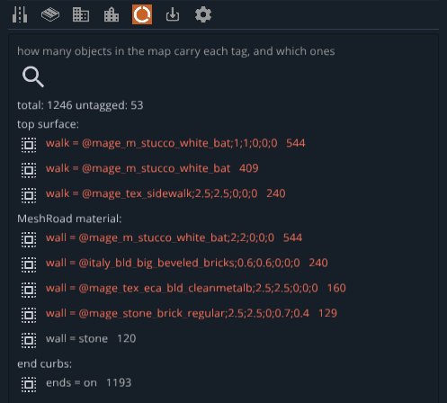

How many objects in the map carry each tag, and which ones. The magnifier scans, a click on a row selects those objects.

---

## import tab - saving the game's tools

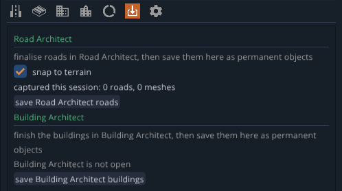

| Tool | What you do |
|---|---|
| **Road Architect** | Finish the roads in Road Architect and save them here as permanent objects. `snap to terrain` puts them on the ground |
| **Building Architect** | Finish the buildings in Building Architect (it has to be open) and save them here |

---

## settings tab

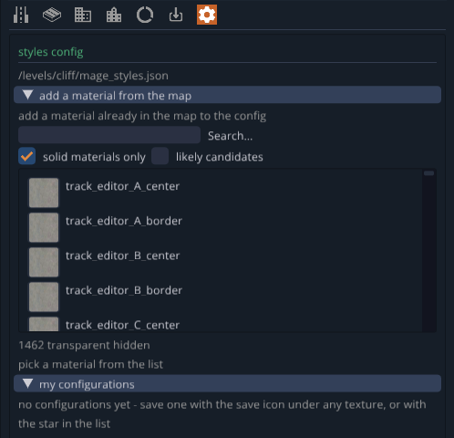

| Control | What it does |
|---|---|
| **styles config** | The path of the map's `mage_styles.json` |
| **add a material from the map** | Adds a material already in the map to the config. `solid materials only` hides transparent ones |
| **my configurations** | Your saved configurations, for all maps |
| **log** | What was built, what was deleted and what changed |

---

## What is saved, and where

| File | Contents |
|---|---|
| `levels/<map>/mage_styles.json` | The map's styles |
| `levels/<map>/art/shapes/mage/mage_*.dae` | The built objects, one file per area |
| `levels/<map>/art/shapes/mage/mage_b*.prefab.json` | A building: its DAE model and its windows and doors |
| `levels/<map>/art/shapes/mage/models/mage_t*.dae` | One shared model for copies of the same building |
| `levels/<map>/art/shapes/mage/*.materials.json` | The materials MaGE uses |
| `levels/<map>/art/shapes/mage/imported/` | Imported DAEs |
| `/settings/mage/` (user folder) | Saved buildings and configurations |
| `/art/shapes/mage/exports/` (user folder) | Exports. Visible in the Asset Browser from any map |

An exported DAE includes its materials, the map's textures and a prefab that places it. You can move it to another map or share it, without MaGE.

---

## Languages

The tool is translated into 14 languages and follows the game's language.

> **The translations are machine-translated and haven't been checked by native speakers.** If you find a wrong string in your language, open an Issue. Even a one-string fix is welcome.

---

## Credits

The geometry was originally written in Python by **rtacyyv**.

**AI use:** translating the geometry algorithms from Python to Lua was done with AI.

---

## License

[AGPL-3.0](https://www.gnu.org/licenses/agpl-3.0.html)
